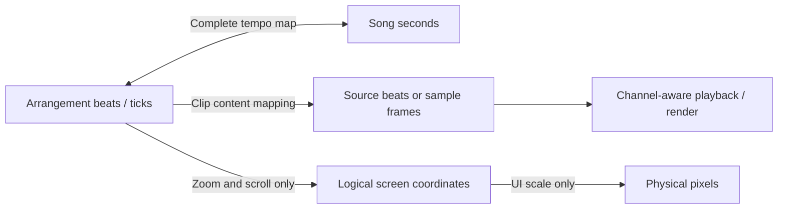

# Tempo, clips and display: target behavior

This is a design contract and migration plan, not a claim that the current engine implements it.

## Four separate coordinate systems

1. **Musical time:** arrangement positions, MIDI note positions, musical automation and loop boundaries. Use quarter-note beats (or integer ticks at a documented PPQ). A 4/4 bar has four quarter-note beats; a 6/8 bar has three. Meter changes the bar ruler, not playback speed.
2. **Song time:** seconds measured from song start, converted through the complete tempo map. For step tempos, sum `segment_beats * 60 / segment_bpm`. The inverse conversion must traverse the same segments. Later support ramps only when playback and export can integrate them consistently.
3. **Source time:** integer audio sample frames and source sample rate. A stereo frame contains both channels. Source sample rate conversion is separate from stretching; playing a 44.1 kHz file on a 48 kHz device must preserve pitch and duration.
4. **Display coordinates:** timeline pixels per beat and UI scale. `x = lane_origin + (beat - scroll_beat) * pixels_per_beat`; physical pixels then apply UI scale. Zoom, scrolling, window resizing and font scale never rewrite notes, clips or audio.

Playback, offline rendering, recording timestamps, source-position lookup and waveform alignment must use these same mappings. Do not implement separate approximate conversions in each view.

## What changing tempo means

At 120 BPM, four beats last two seconds. At 60 BPM, the same four beats last four seconds.

- MIDI notes and clips retain their beat positions and beat lengths. Their durations in seconds change. Musical automation follows the same rule.
- A warped audio clip retains its beat boundaries. Its source-time mapping changes so the source still fills that musical region; the selected warp algorithm determines pitch behavior.
- An unwarped/native-speed recording keeps its source duration in seconds and its beat-anchored start. Its visible end beat is derived from `seconds_to_beats(beats_to_seconds(start_beat) + duration_seconds)`, including tempo changes inside the clip. It does not silently move its start to preserve absolute seconds.
- Absolute-time clips are an explicit alternative for film/dialogue or other fixed-time material. Their start and length are in seconds; the displayed beat locations change with tempo. Never infer this mode from the file type.
- A tempo change at a later beat affects only the beat-to-seconds mapping from that point onward. Lookup must honor that change when seeking or looping into the middle of a song.

Default to musical placement for a music DAW. Make anchor and warp modes visible. Changing tempo must not silently scale all MIDI events and automation points to preserve wall-clock timing.

## Clip operations

| Gesture/action | Changes | Preserves |
|---|---|---|
| Move | Arrangement start | Source selection, rate, note offsets, group spacing |
| Left/right trim | Visible boundaries and relevant content offset | Timing of retained content in the song |
| Slip | Source/content offset | Arrangement boundaries |
| Loop extension | Arrangement duration, repeating a defined source region | Content period and source data |
| MIDI stretch | Note starts/lengths and clip-local automation by one ratio | Pitch, velocity and chosen anchor |
| Audio stretch | Mapping from source frames to song time | Immutable original asset; pitch when in a pitch-preserving mode |
| Varispeed | Playback rate, duration and pitch together | Immutable original asset |
| Duplicate | New clip identity and location | Relative group spacing and content settings; shared immutable audio storage |
| Zoom / UI scale | Display only | Every project and playback value |

For a simple constant-rate audio stretch, source frames advance by `source_frames_per_second * rate * elapsed_song_seconds`. True beat warping through a changing tempo map requires mapping source/warp markers to musical beats, not one constant rate for the whole song. Source offset, selected source range, arrangement duration and looping need distinct fields.

## Model and interaction boundaries

Use stable `ClipId`, `ContentId` and `AssetId`. A clip contains placement, anchor mode and a source/content mapping. Assets own immutable channel-aware media. MIDI content may share copy-on-write storage; normal duplicates must be independently editable. Explicit linked copies can share edits.

An immutable drag baseline captures each clip's placement, duration and content offset. Every preview is derived from that baseline. Clamp one group delta and validate every destination. Commit one undo transaction on release; Escape discards it. Rendering must not mutate the project or initialize device parameters.

Decode, waveform generation and offline stretch run in worker jobs with cancellation and progress. Audio callbacks receive prepared state and bounded control events; they do not decode files or allocate project-sized snapshots. Waveforms and sound must refer to the same asset revision and mapping.

## Current gaps confirmed in Eden

- `TempoMap::bpm_at` currently returns the first tempo and ignores its beat argument; conversion helpers assume constant BPM.
- `rescale_audio_clips` also scales MIDI clips, MIDI notes and automation, despite its comment saying otherwise. This preserves seconds rather than musical positions.
- Playback and export use initial BPM. Fixing only `bpm_at` will not fix their constant-rate stepping or render-duration calculations.
- Several bar/position displays assume four beats per bar instead of the project's time signature.
- True stretch remains unavailable: the misleading TIME STRETCH decoration has been removed. There is no clip source-rate/warp map.
- WAV trims now read source bounds before waveform generation when needed; cold non-WAV source bounds still depend on available metadata.
- Repeated group trim frames, right-resize undo, invalid group/copy destinations and beat-zero group clamping are repaired by immutable gesture baselines. See [clip-editing.md](clip-editing.md) for the implemented contract and remaining ownership gaps.

## Migration order and completion checks

1. Stabilize edit transactions and group constraints, with frame-sequence regression tests.
2. Introduce explicit timing/content types and a versioned project migration. Preserve old projects and source files; make legacy timing choices visible rather than silently changing existing song playback.
3. Implement validated step-tempo conversion and inverse conversion. Test 120→60 BPM at beat 4: beat 4 = 2 seconds, beat 8 = 6 seconds, and 6 seconds converts back to beat 8. Add meter-aware bar labels.
4. Connect playback, export, seeking, native audio duration and source lookup to the same clock. Test transitions inside clips and loop regions, and 44.1/48 kHz source/device combinations.
5. Add explicit native, warped and absolute audio modes. Test a four-beat MIDI pattern remains four beats after a tempo edit; test native audio remains its original duration; test warped audio retains its chosen beat span.
6. Add actual stretch/loop operations with source-preserving derived assets. Test onset positions, duration, pitch behavior, cancellation, save/reopen and undo/redo.
7. Verify zoom and UI-scale changes leave serialized project timing unchanged. Compare offline renders and captured playback on real hardware in addition to automated probes.

Do not treat a beat/time model rewrite as a UI-only patch. Keep layout improvements independent so they can ship without changing existing sound.
